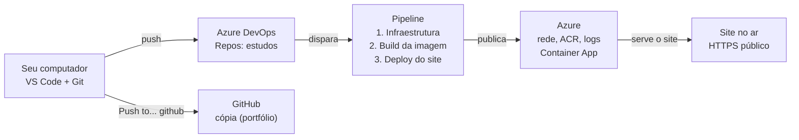

# Do código ao ar: deploy no Azure passo a passo

Guia leigo de tudo o que foi feito para publicar a aplicação no Azure Container Apps, com deploy automático pelo Azure DevOps e cópia no GitHub. Atualizado em 30/10/2026.

## O que foi feito

Um site simples (um jogo em HTML) saiu do computador e foi publicado na nuvem da Microsoft, o **Azure**. A publicação é automática: basta enviar o código, e um robô monta e publica o site sozinho. O primeiro deploy levou cerca de 11 minutos e deixou o site no ar com endereço HTTPS.

Uma cópia do código também foi guardada no **GitHub**, para servir de portfólio.

### Palavras que aparecem no guia

| Termo | O que significa, em palavras simples |
| --- | --- |
| Repositório | A pasta do projeto com todo o histórico de alterações, guardada pelo Git |
| Commit | Uma "foto" das alterações, com uma mensagem dizendo o que mudou |
| Push / Pull | Enviar fotos para o servidor / trazer as fotos do servidor |
| Remote | O endereço de um servidor para onde o repositório envia. Este projeto tem dois: `origin` (Azure DevOps) e `github` |
| Nuvem (Azure) | Computadores da Microsoft alugados por uso |
| Assinatura | A "conta de cobrança" no Azure. Tudo o que é criado fica pendurado nela |
| Resource group | Uma pasta no Azure que agrupa os recursos do projeto. Apagar a pasta apaga tudo dentro |
| Contêiner (Docker) | Uma caixa fechada com o site e o servidor web dentro, que roda igual em qualquer lugar |
| Pipeline | A lista de tarefas que o robô executa a cada envio de código |
| IaC (Bicep) | Infraestrutura descrita em arquivos de texto, em vez de criada clicando no portal |

## O caminho, em uma imagem



O código sai do computador e vai para o Azure DevOps. Lá, o pipeline monta tudo no Azure usando a service connection (a "chave" do Passo 4). O GitHub recebe só uma cópia e não dispara nada.

## Antes de começar: o que você precisa

**Contas (todas gratuitas para criar):**

| Conta | Para que serve | Endereço |
| --- | --- | --- |
| Microsoft Azure | Onde o site roda. Pede cartão de crédito, mas tem créditos e camada gratuita | portal.azure.com |
| Azure DevOps | Guarda o código e roda o robô (pipeline) que publica o site | dev.azure.com |
| GitHub | Cópia pública do código, para portfólio | github.com |

**No computador:**

- **Git**, para versionar o código.
- **VS Code**, o editor, que também faz commit e push com botões.
- **Docker**, opcional, só para testar o site no próprio computador antes de publicar.

Não é preciso instalar a ferramenta de linha de comando do Azure (`az`): os comandos deste guia rodam no **Cloud Shell**, um terminal que abre dentro do próprio portal do Azure.

## Passo 1 — Preparar a assinatura do Azure

O Azure vem com vários serviços "desligados". É preciso ligar (registrar) os que o projeto usa, senão o deploy falha.

| Serviço (resource provider) | Para que serve |
| --- | --- |
| `Microsoft.App` | Container Apps, onde o site roda |
| `Microsoft.ContainerRegistry` | O "depósito" das imagens Docker |
| `Microsoft.OperationalInsights` | Os logs do site |
| `Microsoft.Storage` | Onde o Terraform guarda o estado (só na versão Terraform; o pipeline registra sozinho) |

**Como registrar pelo portal:**

1. Entre em **portal.azure.com**.
2. Pesquise **Assinaturas** e abra a sua (aqui, *Azure subscription 1*).
3. No menu da esquerda: **Configurações → Provedores de recurso**.
4. Filtre pelo nome de cada serviço, selecione e clique em **Registrar**.

**Como conferir pelo Cloud Shell:**

1. No portal, clique no ícone `>_` na barra do topo.
2. Na primeira vez: escolha **Bash**, marque **Não é necessária uma conta de armazenamento**, escolha a assinatura e **deixe desmarcado** "Usar uma rede virtual privada existente". Clique em **Aplicar**.
3. Cole o comando (no Cloud Shell, colar é **Ctrl+Shift+V**):

```bash
for p in Microsoft.App Microsoft.ContainerRegistry Microsoft.OperationalInsights Microsoft.Storage; do echo "$p: $(az provider show -n $p --query registrationState -o tsv)"; done
```

Todos devem aparecer como `Registered`.

## Passo 2 — Criar o projeto no Azure DevOps e enviar o código

O Azure DevOps é um site **separado** do portal do Azure. Ele guarda o código (aba **Repos**) e roda o robô de publicação (aba **Pipelines**).

1. Entre em **dev.azure.com** e crie uma **organização** (aqui: `celsonunes-estudos`).
2. Dentro dela, crie um **projeto** privado (aqui: `estudos`). O endereço fica `dev.azure.com/celsonunes-estudos/estudos`.
3. Envie o código do computador para o repositório do projeto:

```bash
cd ~/Documentos/estudo-azure
git remote add origin https://dev.azure.com/celsonunes-estudos/estudos/_git/estudos
git push -u origin main
```

O nome `estudo-azure` é só o da pasta no computador. No Azure DevOps o repositório se chama `estudos`.

**O que o repositório contém:**

| Pasta / arquivo | Conteúdo |
| --- | --- |
| `app/` | O site (HTML, CSS, JS) e o `Dockerfile` que o coloca dentro do servidor Apache |
| `infra/main.bicep` e `infra/modules/` | A "planta" da infraestrutura base: rede, depósito de imagens, logs e ambiente |
| `infra/app.bicep` | A "planta" do site em si: endereço HTTPS, health check e quantas cópias rodar |
| `azure-pipelines.yml` | As tarefas do robô de publicação |
| `pipelines/destroy.yml` | Robô que apaga tudo no Azure |
| `docs/` | Este guia |

## Passo 3 — Liberar o "robô" gratuito da Microsoft

O pipeline roda num computador emprestado pela Microsoft, chamado **agente hospedado**. Organizações novas começam **sem** esse direito, para evitar abuso. É preciso pedir, uma vez só.

1. Preencha o formulário em **aka.ms/azpipelines-parallelism-request**. A aprovação pode levar alguns dias.
2. Para conferir: em dev.azure.com, clique em **Organization settings** (canto inferior esquerdo) → **Pipelines → Parallel jobs**.
3. Em **Private projects → Microsoft-hosted**, deve aparecer **Free tier: 1 parallel job up to 1800 mins/mo**.

Isso dá 1.800 minutos por mês. Cada deploy completo gasta cerca de 11 minutos, então sobra bastante para estudar.

## Passo 4 — Dar ao robô a "chave" do Azure (service connection)

O Azure DevOps e o Azure são sites diferentes. A **service connection** é a autorização para o robô criar coisas na sua assinatura. Ela funciona **sem senha guardada** (workload identity): o Azure confia diretamente no Azure DevOps.

**Criar:**

1. No projeto, clique em **Project settings** (engrenagem, canto inferior esquerdo) → **Service connections** → **New service connection**.
2. Escolha **Azure Resource Manager** e preencha:
   - Identity type: **App registration (automatic)**
   - Credential: **Workload identity federation**
   - Scope level: **Subscription**, e escolha a sua assinatura
   - Resource group: **em branco**
   - Nome: **`sc-estudo-azure`** (tem que ser exatamente esse; é o nome que o pipeline procura)
   - Marque **Grant access permission to all pipelines**
3. Clique em **Save**.

**Dar a permissão que falta:**

A conexão nasce só com o papel **Contributor** (pode criar recursos). Mas o projeto também precisa **dar permissões** (o site precisa de licença para baixar a imagem do depósito). Isso exige um segundo papel.

1. Abra a conexão `sc-estudo-azure` → **Manage App registration**. Copie o **ID do aplicativo (cliente)**.
2. No **Cloud Shell** do portal Azure, rode (troque os dois valores entre `< >`):

```bash
az role assignment create --assignee <client-id> --role "Role Based Access Control Administrator" --scope /subscriptions/<id-da-assinatura>
```

**Conferir:**

```bash
az role assignment list --assignee <client-id> --scope /subscriptions/<id-da-assinatura> --query "[].roleDefinitionName" -o tsv
```

O resultado certo tem duas linhas: `Contributor` e `Role Based Access Control Administrator`.

## Passo 5 — Criar o pipeline e publicar o site

1. No projeto do Azure DevOps, clique em **Pipelines** → **Create Pipeline**.
2. **Where is your code?** → **Azure Repos Git**.
3. Escolha o repositório **estudos**.
4. **Existing Azure Pipelines YAML file** → branch **main**, caminho **/azure-pipelines.yml** → **Continue**.
5. Clique em **Run**.
6. Se aparecer *"This pipeline needs permission to access a resource"*, clique em **View → Permit**.

O robô executa três etapas, uma depois da outra. Tempos do primeiro deploy:

| Etapa | O que faz | Tempo |
| --- | --- | --- |
| 1 - Infraestrutura | Cria a rede, o depósito de imagens, os logs e o ambiente, lendo o `main.bicep` | 9 min 24 s |
| 2 - Build | Monta a "caixa" Docker com o site e guarda no depósito | 42 s |
| 3 - Deploy | Liga o site com a caixa nova, lendo o `app.bicep` | 1 min 3 s |

A etapa 1 parece travada por vários minutos, sem nada novo no log. É normal: o comando só escreve quando termina, e criar o ambiente leva de 10 a 15 minutos na primeira vez. Nas próximas vezes é bem mais rápido, porque só muda o que for diferente.

O aviso *"The ubuntu-latest label will migrate to Ubuntu 26"* é só informativo. Ele não atrapalha o deploy.

## Passo 6 — Abrir o site e ver o que foi criado

**Achar o endereço do site (escolha um jeito):**

- **No log do pipeline:** abra a execução → etapa **3 - Deploy** → clique na setinha de **Deploy** → passo **Deploy app.bicep** → role até o fim. A última linha diz `Aplicação disponível em: https://...`.
- **No portal:** pesquise **Aplicativos de Contêiner** → abra `hit-game-app` → campo **URL do aplicativo**.
- **No Cloud Shell:**

```bash
az containerapp show -n hit-game-app -g rg-estudo-containerapps --query properties.configuration.ingress.fqdn -o tsv
```

Para testar se o site está saudável, abra o mesmo endereço com `/healthcheck` no final.

**Ver tudo o que foi criado:** no portal, pesquise **Grupos de recursos** → **rg-estudo-containerapps**.

| Recurso | Para que serve | Equivalente na AWS |
| --- | --- | --- |
| `hit-game-app` (Aplicativo de Contêiner) | O site rodando, com HTTPS e até 3 cópias | ECS Service + Load Balancer |
| Container Apps Environment | O "condomínio" onde o site mora | ECS Cluster |
| Container Registry | O depósito das caixas Docker | ECR |
| Rede virtual | A rede privada do ambiente | VPC |
| Identidade gerenciada | O "crachá" do site para entrar no depósito sem senha | IAM Role |
| Log Analytics | Onde ficam os logs | CloudWatch Logs |

Vai aparecer também um grupo com nome começando por **ME_**. O Azure cria e cuida dele sozinho. Não mexa nele.

Lugares bons para explorar: **Visualizador de recursos** (diagrama do grupo), **hit-game-app → Fluxo de log** (acessos em tempo real) e **Revisões e réplicas** (histórico de deploys).

## Passo 7 — Guardar uma cópia no GitHub

O GitHub é só uma cópia para mostrar o projeto. Quem dispara o deploy continua sendo o Azure DevOps.

**1. Criar o repositório vazio.** Em **github.com/new**: nome `estudo-azure`, **Public**, e deixe README, .gitignore e licença **desligados**. Clique em **Create repository**. O push só funciona depois que o repositório existe; antes disso o erro é *"Repository not found"*.

**2. Cadastrar o GitHub como segundo destino (remote):**

```bash
git remote add github https://github.com/celsotux/estudo-azure.git
```

**3. Enviar pelo VS Code (o jeito mais fácil):**

1. Abra **Source Control** (Ctrl+Shift+G).
2. Clique em **`...`** → **Pull, Push** → **Push to...**
3. Escolha **github** (a segunda linha; não aperte Enter direto, senão vai para `origin`).
4. Autorize o login no navegador quando o VS Code pedir.

Pelo terminal também funciona (`git push -u github main`), mas o GitHub não aceita a senha da conta: é preciso um **token** (em github.com/settings/tokens, escopo `repo`). O token é como uma senha: nunca mostre em print, e apague depois de usar.

## No dia a dia: como publicar uma alteração

Toda vez que um arquivo de `app/` ou `infra/` muda e chega ao Azure DevOps, o robô roda sozinho e publica o site novo. Alterações só em `docs/` ou no `README.md` não disparam deploy.

1. Altere os arquivos e salve.
2. No VS Code, em **Source Control**, os arquivos aparecem em **Changes**. Escreva uma mensagem e clique em **Commit**.
3. Clique em **Sync Changes**: isso envia ao **Azure DevOps** e dispara o deploy.
4. Para atualizar a cópia no GitHub: **`...` → Pull, Push → Push to... → github**.

| Botão no VS Code | Para onde vai |
| --- | --- |
| Commit | Só no seu computador |
| Sync Changes | Azure DevOps (`origin`), dispara o deploy |
| Push to... → github | GitHub |

**Cuidado com o commit vazio.** Se a lista **Changes** estiver vazia, não clique em Commit nem aperte Ctrl+Enter na caixa de mensagem. O VS Code cria um commit sem nada dentro. Para desfazer o último commit (sem perder arquivos):

```bash
git reset --soft HEAD~1
```

- [ ] Configurar o login do VS Code no Azure DevOps com um Personal Access Token (User settings → Personal access tokens, escopo **Code: Read & Write**). Sem isso, o Sync pede senha e falha.

## Problemas que apareceram e como resolver

| O que aconteceu | Por quê | Solução |
| --- | --- | --- |
| Cloud Shell pediu "Grupo de recursos" e "Rede virtual" | A caixa "Usar uma rede virtual privada existente" ficou marcada | Clicar em **Anterior** e desmarcar a caixa |
| `remote: Repository not found` no push para o GitHub | O repositório ainda não tinha sido criado no site | Criar em github.com/new e repetir o push |
| `error: remote github already exists` | O remote já tinha sido cadastrado antes | Nenhuma; pode seguir para o push |
| Janela de senha do `dev.azure.com` no VS Code | O Sync ou o fetch automático falam com o Azure DevOps, e o VS Code não tem login lá | Apertar **Esc**; resolver depois com um token do Azure DevOps |
| `Authentication failed` para o Azure DevOps | Mesmo motivo acima | Mesma solução acima |
| Botão **Sync Changes 1** sem ter alterado nada | Um commit vazio foi criado sem querer | `git reset --soft HEAD~1` e clicar em ↻ no Source Control |
| Token do GitHub apareceu em print | O token fica visível logo depois de gerado | Apagar o token (Delete) depois de usar |
| `(SubscriptionNotFound) Subscription ... was not found` no pipeline do Terraform | O serviço `Microsoft.Storage` não estava registrado; o Azure dá essa mensagem enganosa | `az provider register --namespace Microsoft.Storage` (o pipeline agora faz isso sozinho) |
| Etapa 1 do pipeline "parada" por 9 minutos | Criar o ambiente do Container Apps demora | Esperar; só investigar se passar de 25 minutos |

## Custos e como desligar tudo

O que mais custa, mesmo com o site parado, é o **Container Registry** (cerca de US$ 5 por mês). O site em si, com 1 cópia ligada, fica dentro ou perto da cota gratuita mensal do Container Apps. Os logs cobram pelo volume guardado.

**Para ver quanto está gastando:** portal → **Gerenciamento de Custos**, filtrando pelo grupo `rg-estudo-containerapps`.

**Para apagar tudo:**

1. Crie o segundo pipeline como no Passo 5, mas escolhendo o arquivo **/pipelines/destroy.yml**. Na tela final, use a seta ao lado de **Run** → **Save** (salvar sem rodar).
2. Quando quiser apagar, rode esse pipeline e digite `rg-estudo-containerapps` no campo de confirmação.
3. Ele apaga o grupo inteiro e tudo dentro. Para voltar, basta rodar o pipeline de deploy de novo.

**Próximos passos possíveis:**

- [ ] Criar e salvar o pipeline de remoção
- [ ] Trocar `ubuntu-latest` por `ubuntu-24.04` nos pipelines, para sumir o aviso
- [ ] Refazer a mesma infraestrutura em Terraform, para comparar com o Bicep
