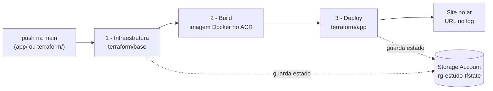

# Deploy com Terraform

Esta pasta descreve, em Terraform, a mesma infraestrutura que a pasta [`infra/`](../infra) descreve em Bicep. As duas versões rodam **em paralelo**, cada uma no seu resource group:

| | Bicep | Terraform |
|---|---|---|
| Código | `infra/` | `terraform/` |
| Pipeline de deploy | `azure-pipelines.yml` | `pipelines/terraform.yml` |
| Pipeline de remoção | `pipelines/destroy.yml` | `pipelines/terraform-destroy.yml` |
| Resource group | `rg-estudo-containerapps` | `rg-estudo-containerapps-tf` |

Quem controla tudo é o **Azure DevOps**: o Terraform nunca roda no seu computador, só dentro do pipeline.

## Como o deploy funciona



| Estágio | O que acontece |
|---|---|
| 1 - Infraestrutura | Cria a Storage Account do estado (só na primeira vez) e roda `terraform plan` + `terraform apply` em `terraform/base` |
| 2 - Build | Monta a imagem Docker da pasta `app/` e envia ao ACR criado no estágio 1 |
| 3 - Deploy | Roda `terraform plan` + `terraform apply` em `terraform/app` com a imagem nova e escreve a URL do site no log |

O pipeline roda sozinho a cada push na `main` que altere `app/` ou `terraform/`, e também pode ser rodado manualmente.

## O que tem em cada pasta

| Pasta | Cria | Equivale a |
|---|---|---|
| `base/` | Resource group, Container Registry (ACR), identidade gerenciada + permissão AcrPull, Log Analytics e Container Apps Environment | `infra/main.bicep` |
| `app/` | O Container App: imagem, HTTPS, health check em `/healthcheck` e de 1 a 3 réplicas | `infra/app.bicep` |

Cada pasta tem os mesmos quatro arquivos:

| Arquivo | Para que serve |
|---|---|
| `versions.tf` | Versão do Terraform e do provider `azurerm`, e onde o estado fica guardado |
| `variables.tf` | Valores que podem mudar (nomes, região, réplicas) |
| `main.tf` | Os recursos em si |
| `outputs.tf` | O que o módulo devolve (por exemplo, a URL do site) |

O arquivo `.terraform.lock.hcl` trava a versão exata dos providers (`azurerm` 4.81.0), para o pipeline sempre usar a mesma.

## O "estado" do Terraform

O Terraform guarda num arquivo, o **estado**, tudo o que ele já criou. É assim que ele sabe o que mudar no próximo deploy e o que apagar no `destroy`. O Bicep não tem isso: quem guarda o estado é o próprio Azure.

Neste projeto, o estado fica na nuvem, não no computador:

| Item | Valor |
|---|---|
| Resource group | `rg-estudo-tfstate` |
| Storage Account | `sttf` + os 12 primeiros caracteres do ID da assinatura |
| Container | `tfstate` |
| Arquivos | `base.tfstate` e `app.tfstate` |

O pipeline cria esse armazenamento sozinho na primeira execução (função `tfstate_bootstrap` em [`pipelines/scripts/terraform-env.sh`](../pipelines/scripts/terraform-env.sh)). Ele fica num resource group separado de propósito: assim o `destroy` apaga o site, mas o estado continua lá para o próximo deploy.

Os dois módulos têm estados separados. O `app` lê o que o `base` criou (ACR, identidade, Environment) com `terraform_remote_state`, direto do arquivo `base.tfstate`.

## Como o Terraform entra no Azure

Pela mesma service connection `sc-estudo-azure` da versão Bicep, **sem senha guardada**. O passo [`pipelines/templates/terraform-step.yml`](../pipelines/templates/terraform-step.yml) usa a tarefa `AzureCLI@2` com `addSpnToEnvironment: true`, e o script repassa o token de workload identity ao Terraform:

| Variável | Valor |
|---|---|
| `ARM_CLIENT_ID` | ID da service connection |
| `ARM_TENANT_ID` | ID do diretório |
| `ARM_SUBSCRIPTION_ID` | ID da assinatura |
| `ARM_OIDC_TOKEN` | Token temporário gerado pelo Azure DevOps |
| `ARM_USE_OIDC` | `true` |

As permissões são as mesmas da versão Bicep: **Contributor** e **Role Based Access Control Administrator** na assinatura.

## Primeira vez: criar os pipelines no Azure DevOps

1. Em **Pipelines → New pipeline**, escolha **Azure Repos Git → estudos → Existing Azure Pipelines YAML file**.
2. Branch **main**, caminho **/pipelines/terraform.yml** → **Continue** → **Run**. Se aparecer *"This pipeline needs permission to access a resource"*, clique em **View → Permit**.
3. Repita com **/pipelines/terraform-destroy.yml**, mas use **▾ → Save** (salvar sem rodar).
4. Renomeie os dois em **⋮ → Rename/move** (por exemplo `terraform-deploy` e `terraform-destroy`).

O primeiro deploy leva alguns minutos. A URL do site aparece no fim do log do estágio **3 - Deploy**, na linha `Aplicação disponível em: https://...`.

## Remover o ambiente

1. Rode o pipeline **terraform-destroy**.
2. No campo de confirmação, digite `rg-estudo-containerapps-tf`. Com outro valor, ele para sem apagar nada.
3. Ele roda `terraform destroy` primeiro no `app` e depois na `base`.

O resource group `rg-estudo-tfstate` (só o estado) continua existindo e custa centavos por mês. Para subir tudo de novo, basta rodar o pipeline de deploy.

## Testar o código no seu computador (opcional)

Só confere se o código está escrito certo, sem criar nada no Azure:

```bash
terraform -chdir=terraform/base init -backend=false
terraform -chdir=terraform/base validate
terraform fmt -check -recursive terraform
```

## Bicep x Terraform, na prática

| | Bicep | Terraform |
|---|---|---|
| Nuvens | Só Azure | Azure, AWS, GCP e outras |
| Estado | Guardado pelo Azure | Arquivo `.tfstate` que precisa de um lugar (aqui, a Storage Account) |
| Ver antes de aplicar | `what-if` | `terraform plan` (aparece no log do pipeline) |
| Remover | Apagar o resource group | `terraform destroy`, recurso por recurso |
| Instalação no pipeline | Já vem na Azure CLI | O script baixa a versão fixa (1.16.7) |
